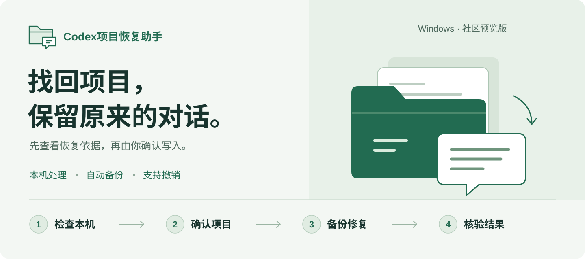
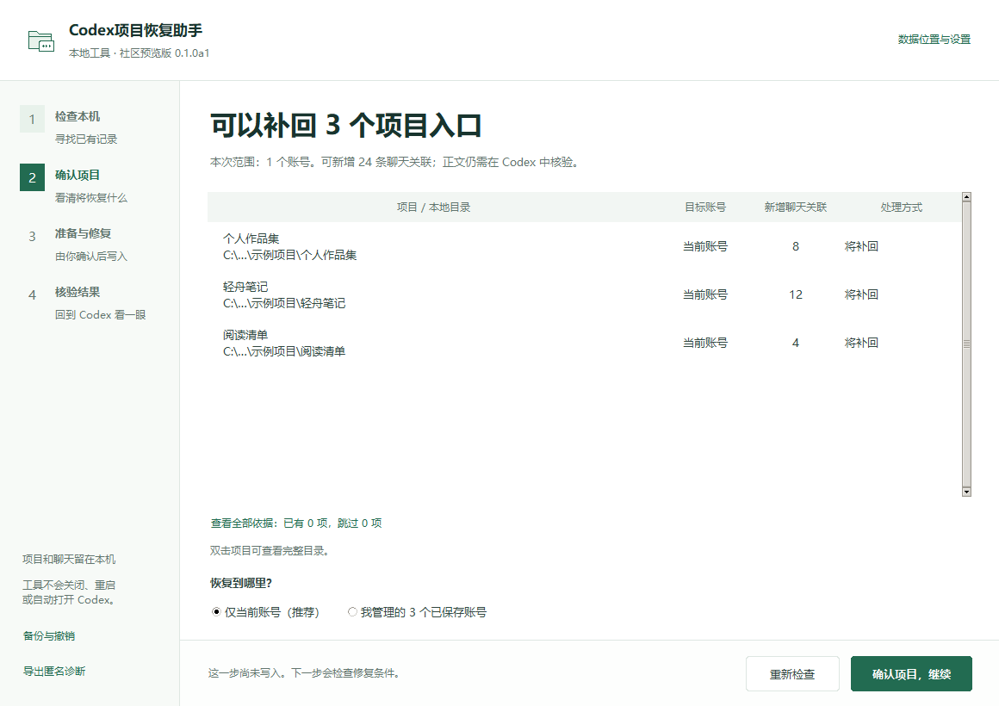

<h1 align="center">Codex项目恢复助手</h1>

<p align="center"></p>

<p align="center"><strong>先查看恢复证据，再找回丢失的本地项目列表与聊天归属。</strong></p>

<p align="center"><a href="#快速开始">开始使用</a> · <a href="#如何使用">恢复步骤</a> · <a href="docs/recovery-model.md">恢复原理</a> · <a href="#支持范围与限制">支持范围</a></p>

<p align="center">  </p>

## 解决什么问题

独立社区工具，不是 OpenAI 官方修复程序。当前为 `0.1.0a1` 预览版。扫描不修改 Codex；应用修复需由你手动退出 Codex。不能保证所有丢失数据都能恢复，也不保证升级或未来新账号会自动同步。

本地文件夹和旧聊天仍在，Codex 左侧却显示“没有项目”。项目目录、数据库记录、账号侧栏状态是不同的数据层；仅重新添加文件夹，可能建立一个没有旧聊天的新项目入口。

这个工具从已有状态与数据库中确认原项目身份，生成可审阅的恢复预览。它不会新建项目 ID，也不会按聊天目录猜测归属。

如果当前项目状态已经完整，窗口却仍为空，工具会提示排查界面加载问题，而不是反复写入配置。社区在 macOS 上报告过“文件 → 新建窗口”的免退出绕行方法；Windows 尚未在本项目验证。[案例与证据边界](docs/recovery-model.md)

## 使用示例



上图是实际运行的工具界面，使用独立的合成数据目录：

```text
找到 3 个可明确识别的普通本地项目。
当前账号：现有项目 0 → 恢复后项目 3；新增聊天关联 24
本次仅选择当前账号；其他已保存账号不在写入范围内。
```

这是合成数据示例，不是实际用户的恢复数量。预览、写入成功、界面恢复是三个不同状态；写入后仍需打开 Codex 检查原项目和旧聊天。

## 快速开始

### Windows 图形界面

推荐下载 [Windows 便携预览版 v0.1.0a1](https://github.com/ZhangShixing0/codex-project-rescue/releases/tag/v0.1.0a1)，无需安装 Python：

1. 在下载页的 Assets 中选择 `CodexProjectRescue-0.1.0a1-windows-x64.zip`，解压到独立文件夹。
2. 双击 `CodexProjectRescue.exe`，点击“开始检查”。此时可以保持 Codex 打开。
3. 按四步引导确认项目、准备修复并核验结果。下载页同时提供 `SHA256SUMS.txt` 校验值。

此版本是社区预览版，尚未代码签名，当前写入仅支持下文列出的 Codex 版本。请从本仓库的 Releases 下载。

### 从源码运行

需要 **Python 3.11 或更高版本，包含 tkinter**，运行时仅用 Python 标准库。版本与入口定义见 [pyproject.toml](pyproject.toml)。

1. 下载本仓库 ZIP 并解压，或克隆仓库。
2. 双击 `start-windows.cmd`，或在解压目录运行：

   ```powershell
   python launch.py
   ```

3. 点击“开始检查”。此时可以保持 Codex 打开。

GitHub Actions 的 `Checks` 工作流也会构建 `CodexProjectRescue-Windows-preview` 制品，供开发验证；制品下载需要登录 GitHub，保存 14 天。普通用户优先使用 Releases 中的预览包。本版暂不提供自动更新。

### 命令行

```powershell
python -m pip install -e .
codex-project-rescue scan
codex-project-rescue --scope all scan
codex-project-rescue scan --json
```

`--home` 可指定 Codex 数据目录；默认使用 `CODEX_HOME`，否则使用用户目录下的 `.codex`。工具不会读取登录凭据文件。

## 如何使用

1. **检查本机。** 点击“开始检查”，识别已有项目和明确的聊天关联。默认位置通常无需更改；有历史状态文件时，可从“数据位置与设置”选取。
2. **确认项目。** 表格显示目标账号、将补回的项目及新增聊天关联；双击项目可看完整目录。“查看全部依据”列出已有和跳过的项目。默认仅恢复当前账号，也可选择你管理的所有已保存账号；切换范围会重新生成只读预览。
3. **准备与修复。** 检查版本、备份位置、应用运行状态和预览有效性。准备好后由你手动退出 Codex，保持本工具打开，点击“重新检查运行状态”；条件满足后点击“备份并修复”。未知版本不会要求你退出，也不允许写入。
4. **核验结果。** 手动打开 Codex，检查原项目和几条旧聊天，再点击“我已核验项目和旧聊天”。工具将用户确认与自动验证区分记录；它不会自动启动或关闭 Codex。

建议从资源管理器独立启动本工具。不要从 Codex 内置终端启动后依赖它在 Codex 退出时继续运行。扫描失败时也可导出匿名诊断，不必先得到成功预览。

备份默认保存在 `%LOCALAPPDATA%\CodexProjectRescue\backups`，不在 Codex 数据目录内。可以更改位置。备份包含私有账号状态及本地数据库，请保留在自己的电脑。

撤销：手动退出 Codex，在工具的“备份与撤销”中按时间选择一次修复，再点击“撤销所选修复”。列表只显示当前数据目录对应的备份。只撤销此次修改的项目字段，保留其他新设置；如果项目字段已有后续变化，会拒绝覆盖。[备份与撤销细节](docs/recovery-model.md#备份与撤销)

## 支持范围与限制

| 项目 | 当前行为 |
| --- | --- |
| 实际写入平台 | Windows |
| 已核对写入版本 | Microsoft Store `OpenAI.Codex 26.1103.4239.0` |
| 其他版本 | 能识别状态格式时允许只读扫描，拒绝写入 |
| 项目来源 | 当前/已保存账号状态、可选历史 JSON、现有 `state_5.sqlite` |
| 多账号 | 按执行时保存的账号动态处理；修复后首次登录的新账号需重新同步 |
| 云端关联项目 | 本版不迁移、不解除关联，保留已有记录 |
| 缺失或冲突 | 跳过并报告，不创建替代项目，不推测聊天归属 |
| 会话文件 | 检查文件存在，包括 `.jsonl.zst`；不证明正文完整或可以正常打开 |
| 不适用 | 恢复已删除文件、已删除会话正文、跨 Windows 用户迁移、云端项目找回 |

**只有本地目录存在，并不足以承诺聊天归属恢复。** 项目列表、身份映射、线程索引或会话文件缺失时，需要分别判断。

## 隐私与安全

工具没有遥测、网络请求、后台服务、计划任务或自动账号切换。它不修改 SQLite、会话正文、项目源码、登录信息、迁移标记或文件访问授权。两个 JSON 文件分别替换，不能作为一个跨文件原子事务；中途断电时应保留备份并检查状态。

匿名诊断可以分享，完整备份包含私人数据。请勿将备份和真实聊天上传到公开 Issue。[安全说明](SECURITY.md)

## 开发与验证

```powershell
python -m unittest discover -s tests -v
python -m compileall -q src launch.py
python -m pip install pyinstaller==6.16.0
python -m PyInstaller --noconfirm --clean --onefile --windowed --name CodexProjectRescue --paths src launch.py
python scripts/package_windows.py
```

测试使用临时合成账号、项目和数据库，覆盖多账号变化、原 ID 保留、冲突保护、过期预览、写入失败回滚、撤销与匿名报告。它们不等于在每个 Codex 版本或每台电脑上验证成功。

发布包使用独立 Windows CPython 3.13 环境构建，携带运行库许可和 SHA-256 校验值。打包脚本拒绝 Conda 环境，以避免将本机其他软件的动态库混入分发文件。[第三方说明](THIRD_PARTY_NOTICES.md)

不建议直接扩展版本白名单：先核实对应版本的项目状态格式、账号切换行为及合成数据测试，再记录适配证据。欢迎贡献匿名诊断和最小复现。[贡献指南](CONTRIBUTING.md) · [隐私与安全](SECURITY.md)

## 来源与许可

恢复思路参考 GitHub 社区已报告成功的案例：[原 ID 与侧栏记录恢复 #54538](https://github.com/openai/codex/issues/54538)、[账号切换与窗口加载问题 #59895](https://github.com/openai/codex/issues/59895)。本工具代码独立编写，不直接复制他人案例脚本，不把社区报告当成官方兼容承诺。

源码采用 [MIT 许可证](LICENSE)。便携版所含运行库保留各自许可，见[第三方说明](THIRD_PARTY_NOTICES.md)。本项目不使用 OpenAI 标志，不隶属于 OpenAI。
